# Sama

A commerce platform built for Google Cloud. Angular storefront, Kotlin app, six .NET
microservices behind one API gateway, deployed to GKE.

[](https://github.com/ahmedselimmansor-ctrl/sama-commerce/actions/workflows/ci.yml)

| | |
|---|---|
| **Backend** | .NET 10, six services plus a YARP gateway |
| **Storefront** | Angular 22, standalone, signals, zoneless |
| **Mobile** | Kotlin, Jetpack Compose, Hilt |
| **Data** | PostgreSQL 16 (schema per service), Redis, Pub/Sub |
| **Platform** | GKE Autopilot, Cloud SQL, Memorystore, Cloud Armor, Cloud CDN |
| **Tests** | 168 — unit, integration, end-to-end |

---

## Contents

- [System design](#system-design)
- [The checkout saga](#the-checkout-saga)
- [Database design](#database-design)
- [The storefront](#the-storefront)
- [Security](#security)
- [Deployment](#deployment)
- [Running it locally](#running-it-locally)
- [Testing](#testing)
- [Repository layout](#repository-layout)

---

## System design

### Context

Three clients, one public edge. Nothing reaches a service directly.

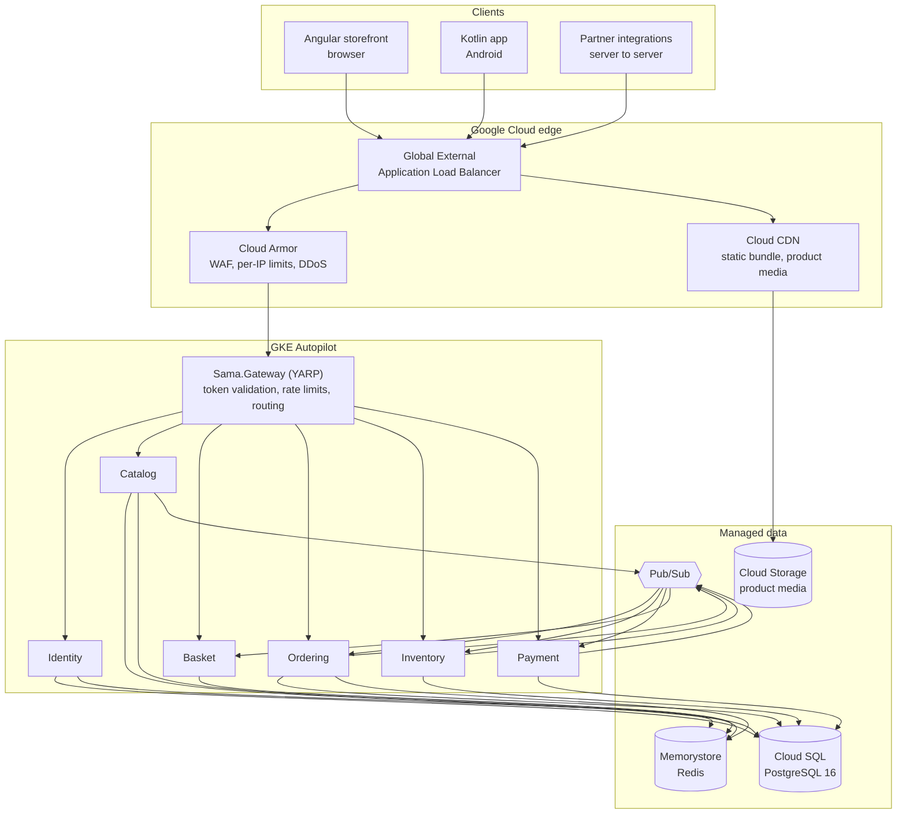

### Services and what each one owns

Nothing reads another service's tables. Cross-service reads go over HTTP; cross-service writes
go through events.

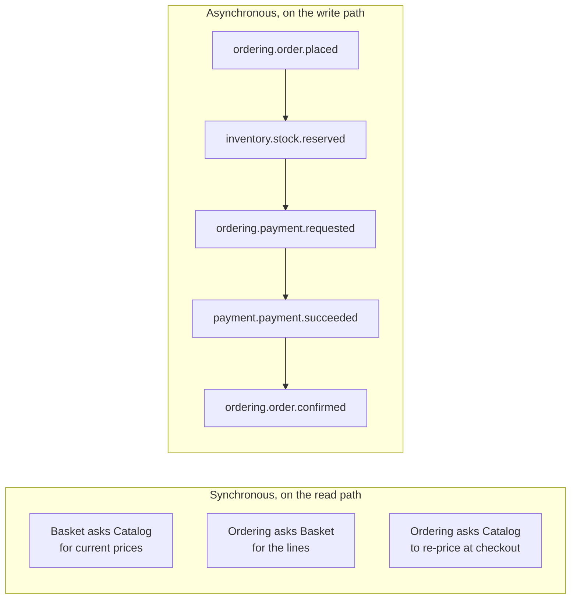

| Service | Owns | Store | Emits |
|---|---|---|---|
| **Gateway** | edge policy | Redis (limits) | — |
| **Identity** | users, roles, refresh tokens | `identity` schema | `user.registered` |
| **Catalog** | products, categories | `catalog` schema | `product.priceChanged`, `product.published` |
| **Basket** | active carts | Redis only | — |
| **Ordering** | orders, saga state | `ordering` schema | `order.placed`, `payment.requested`, `order.confirmed`, `order.cancelled` |
| **Inventory** | stock, reservations | `inventory` schema | `stock.reserved`, `stock.rejected` |
| **Payment** | payment intents | `payment` schema | `payment.succeeded`, `payment.failed` |

Baskets live in Redis and orders live in PostgreSQL because the two have different worth: a
lost basket is an annoyance, a lost order is a financial incident.

### How a product read is served

Four layers answer before the database does. The interesting part is what each one buys.

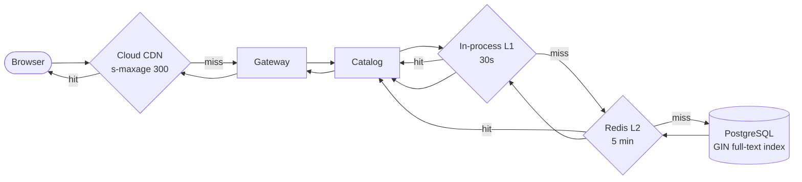

L1 absorbs the repeat reads one pod makes within seconds. L2 stops a newly-scaled pod arriving
with a cold cache and stampeding the database. `HybridCache` collapses concurrent misses for
the same key into one factory call, so a hot key expiring costs one query rather than a
hundred.

Writes invalidate by **tag**, not by key: one price change has to evict the product page, its
category listing and every filtered search page it appears on, and those keys cannot be
enumerated at write time.

### Rate limiting, three layers deep

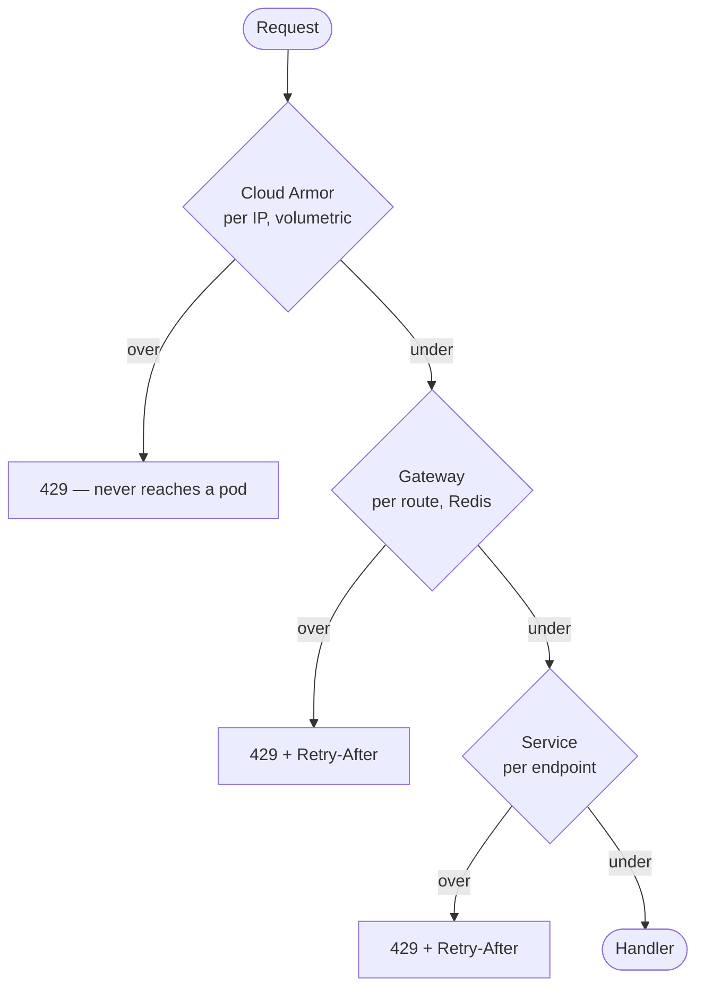

The limiter is distributed because an in-process one on N replicas permits N times the
configured rate, and the replica count changes under autoscaling. It uses a sliding-window
**log** rather than a fixed-window counter: the cheaper counter allows a double burst across a
window boundary, and for login throttling that doubling is the whole attack.

The edge **fails closed** and the services **fail open**. A Redis outage must not silently
remove all throttling from the internet-facing tier, but it also should not stop a shop
trading.

---

## The checkout saga

An order spans four services, so it is coordinated by events with compensating actions rather
than a distributed transaction.

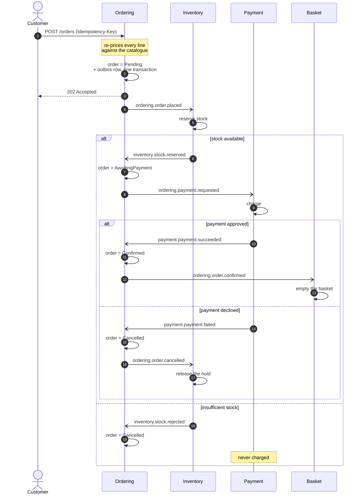

Stock is reserved **before** payment is taken. The common failure — an item selling out between
browsing and checkout — then costs a rejection rather than a charge followed by a refund.

### Order states

Every transition goes through a guarded method on the aggregate, which is what makes a
redelivered or out-of-order event a no-op instead of a corruption.

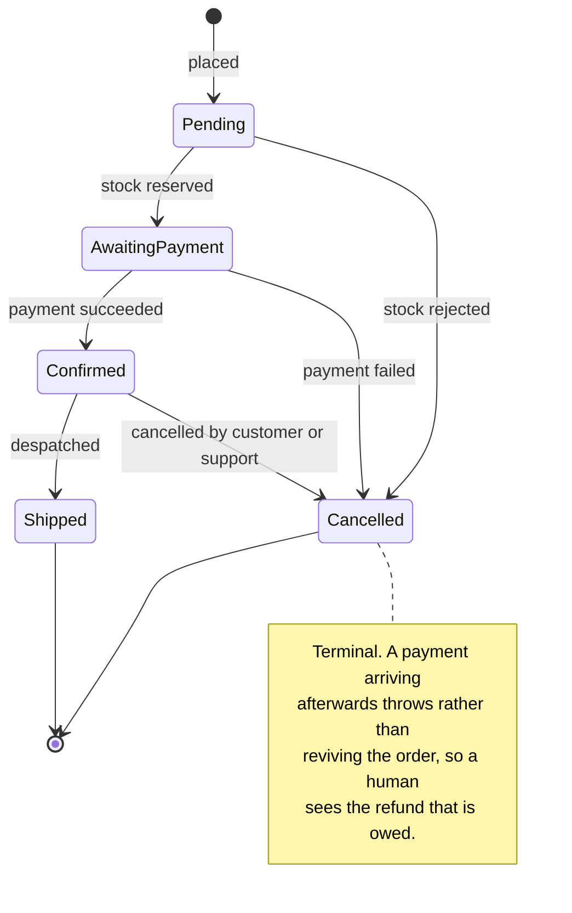

### Why the outbox exists

Publishing directly from a request handler has two failure modes and no good answer to either.

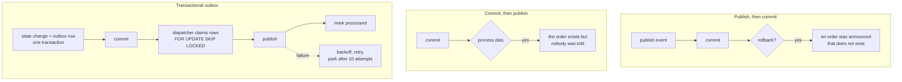

`FOR UPDATE SKIP LOCKED` is what lets every replica run a dispatcher and compete for the same
rows without a leader election or a distributed lock — each row goes to exactly one replica per
pass, and throughput scales with replica count.

---

## Database design

One Cloud SQL instance, a **schema per service**, and a **database role per service** with
grants on only its own schema. A compromised catalogue service cannot read the users table, and
a schema can be lifted onto its own instance later by changing one connection string.

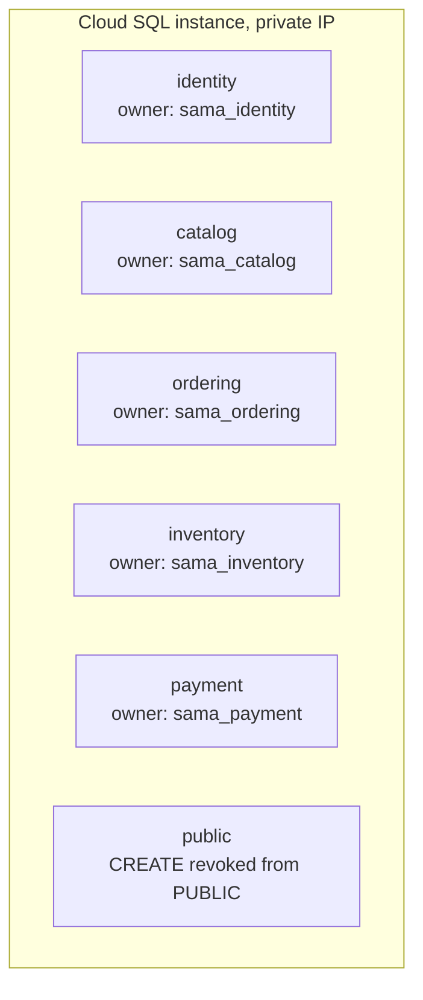

### Identity

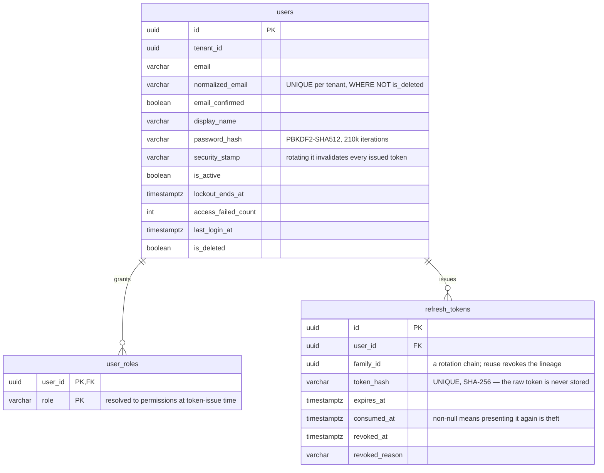

### Catalog

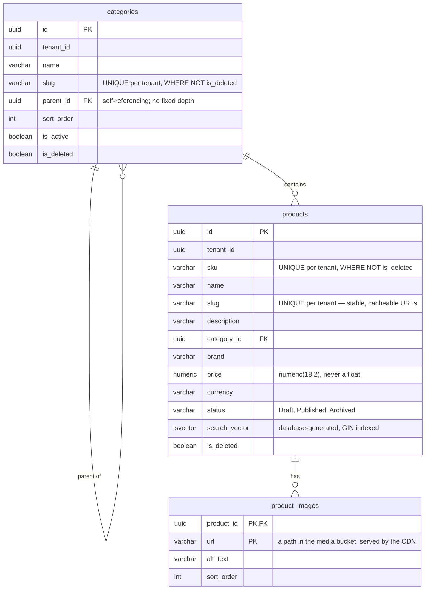

Prices are `numeric(18,2)`, never a float: binary floating point cannot represent 0.10 exactly,
and money that does not add up is the fastest way to lose a merchant's trust.

The `search_vector` is generated **by the database** from name, brand and description, so it
can never drift from the row the way an application-maintained copy would.

### Ordering, Inventory and Payment

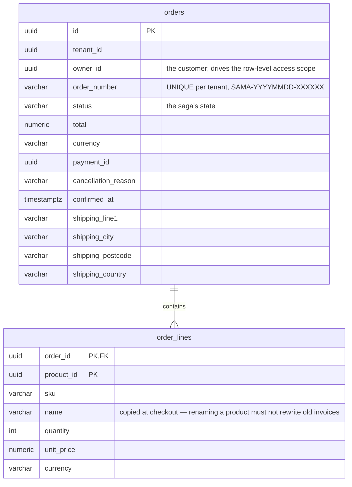

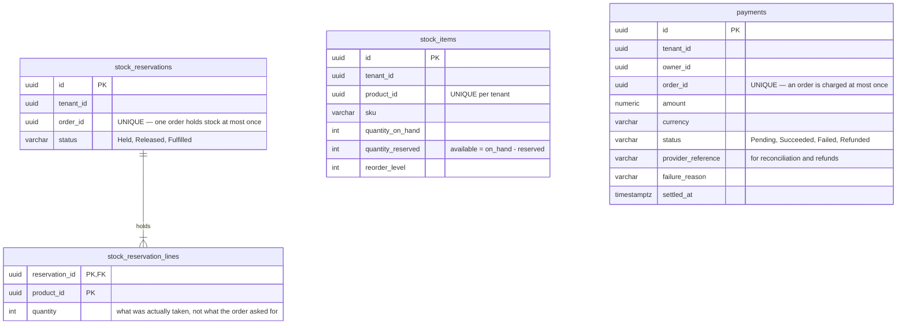

Two unique indexes carry most of the saga's safety: `stock_reservations.order_id` means a
redelivered `order.placed` cannot double-hold, and `payments.order_id` means a redelivered
`payment.requested` cannot double-charge. Idempotency is enforced by the database, not only by
a handler remembering to check.

### The outbox table, in every schema

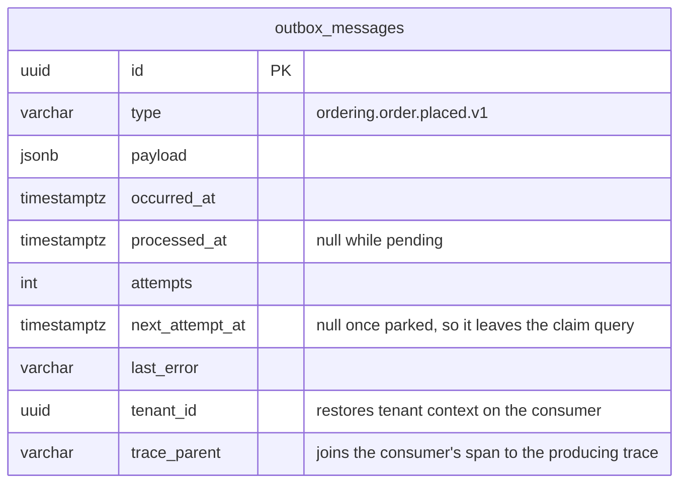

Indexed `(next_attempt_at, occurred_at) WHERE processed_at IS NULL`, so the dispatcher's only
query stays on the small unprocessed tail rather than the whole history.

### Conventions across every table

| Convention | Why |
|---|---|
| `snake_case` names | PostgreSQL folds unquoted identifiers to lower case; PascalCase would need quoting in every hand-written query, forever |
| UUIDv7 primary keys | Unguessable in a URL, but time-ordered, so inserts stay at the right edge of the B-tree instead of scattering |
| `xmin` concurrency token | Optimistic concurrency without a column to maintain; two replicas updating one aggregate collide loudly |
| Audit columns | Stamped by a SaveChanges interceptor, never by the caller |
| Soft delete | Orders and other services reference these ids; a hard delete strands them |
| Partial unique indexes | `WHERE is_deleted = false`, so a withdrawn product does not reserve its slug forever |
| `tenant_id` on scoped tables | Enforced by a model-level query filter, so a forgotten `WHERE` cannot leak across tenants |

---

## The storefront

Three departments — Clothing, Shoes and Electronics — sit behind one catalogue
component; a department is `/shop` with its category pinned and its own editorial
masthead. The home page opens on the departments rather than a wall of products,
because its single job is to route someone into one of three rooms.

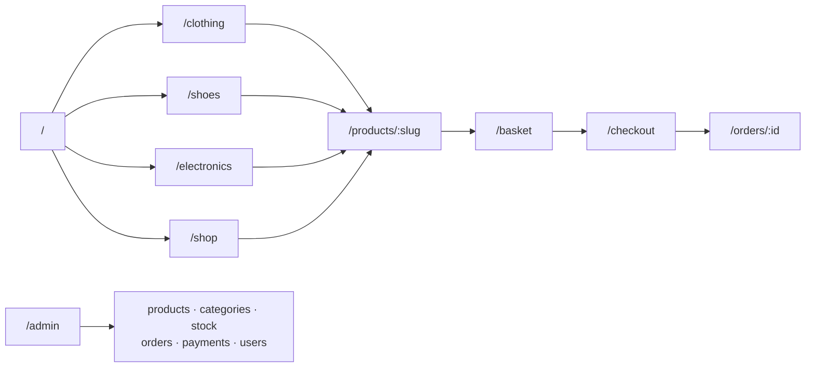

Every route is lazily loaded, and `/admin` is guarded on the parent so a child
cannot be reached directly. That decides what renders; the API decides what may
actually be read or changed.

The interface is bilingual English and Arabic, switchable at runtime, with the
whole layout mirroring for RTL through CSS logical properties. The catalogue is
bilingual too: each product carries an optional Arabic name and description, both
travel in one payload so switching language needs no refetch, and both are
indexed for full-text search. Light and dark are
joined by a third "match system" state that keeps following the operating system.
Both choices survive a reload and are applied before first paint.

Product imagery is served from Unsplash over the CDN; `scripts/seed-shop.sh`
fills the three departments with 22 priced, photographed, in-stock products so
the design can be judged against real content rather than placeholders.

See [the design system](docs/04-design-system.md) for the palette, the type
pairing, and the encapsulation trap that made Arabic headings render in a
Latin-only face.

---

## Security

The full model is in [docs/02-security.md](docs/02-security.md). The token flow in brief:

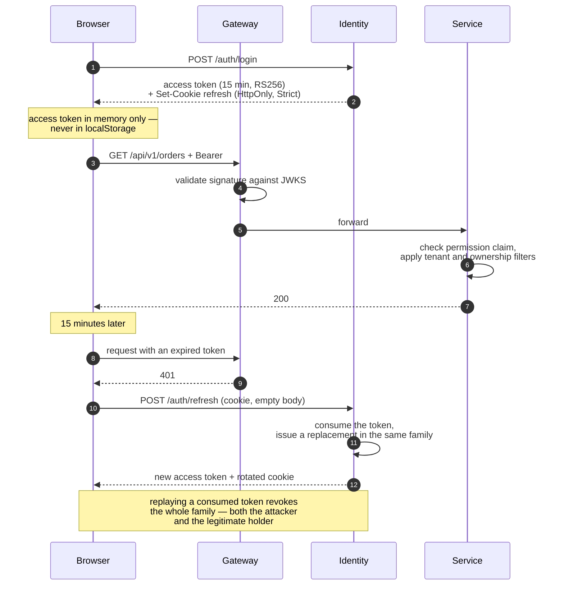

Access tokens are signed **asymmetrically**. With a shared secret every resource service would
hold the key that mints tokens, so compromising any one of them would let an attacker forge an
administrator. With RSA they can verify and cannot issue.

Authorization is **permission-based**: endpoints require `catalog:product:write`, never "is
this an admin". Roles are bundles resolved at token-issue time, so re-shaping who can do what
never means editing endpoints.

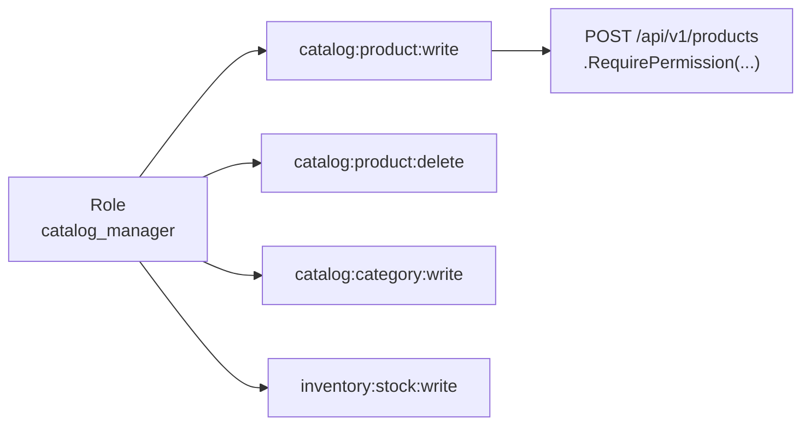

Permissions ending `.own` and `.any` form a pair. The scope becomes a predicate **inside the
SQL**, so the database never returns rows the caller may not see.

---

## Deployment

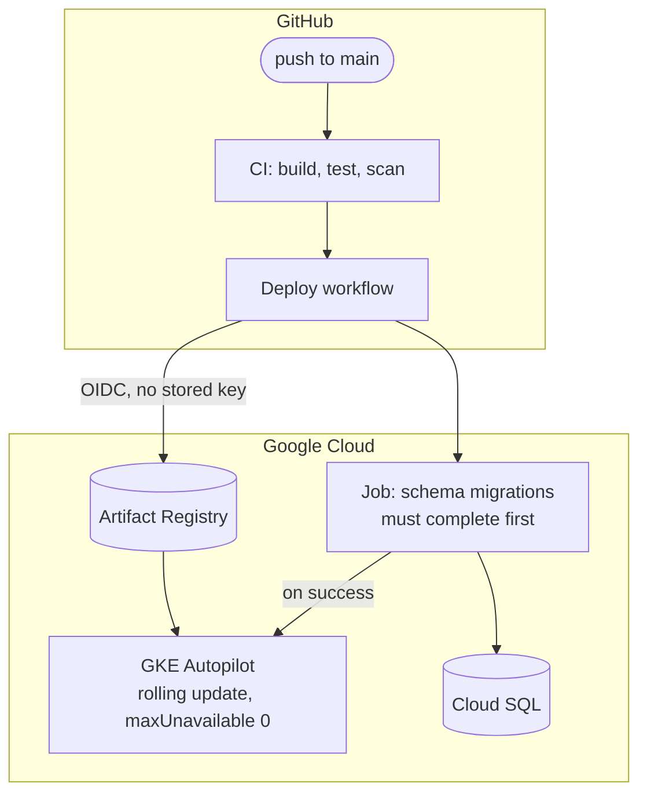

Migrations run as a **Job that must complete** before any new pod starts. Applying them from
application startup instead would have every replica race to run them, and would present a
failed migration as a crash-looping deployment rather than a failed job with a readable log.

Images are tagged with the commit SHA, so a rollback is a re-point rather than a rebuild.

```bash
cd deploy/terraform && terraform init -backend-config="bucket=YOUR_STATE_BUCKET"
```

```bash
terraform apply -var-file=environments/prod.tfvars
```

This creates the VPC, GKE Autopilot cluster, Cloud SQL, Memorystore, Pub/Sub, Cloud Armor
policies, Artifact Registry and the Secret Manager entries. Two secrets are created **empty**
on purpose, because Terraform must never see their values:

```bash
gcloud secrets versions add sama-identity-signing-keys-0-privatekeypem --data-file=signing-key.pem
```

Point DNS at the `ingress_ip` output, then:

```bash
kubectl apply -k deploy/k8s/overlays/prod
```

---

## Running it locally

```bash
docker compose up -d
```

```bash
./scripts/run-local.sh start
```

That brings up PostgreSQL, Redis and the Pub/Sub emulator, provisions the topics and
subscriptions, builds once, and starts all seven services. `status` shows readiness, `stop`
shuts them down.

**Ports.** The gateway is on `8080` and is the only one a client needs. PostgreSQL and Redis
are mapped to **55432** and **56379** rather than their defaults, because those are frequently
already taken.

Apply the schema once:

```bash
dotnet dotnet-ef database update --project src/services/Sama.Identity/Sama.Identity.csproj
```

Then the storefront:

```bash
cd src/web/sama-web && npm install && npm start
```

---

## Testing

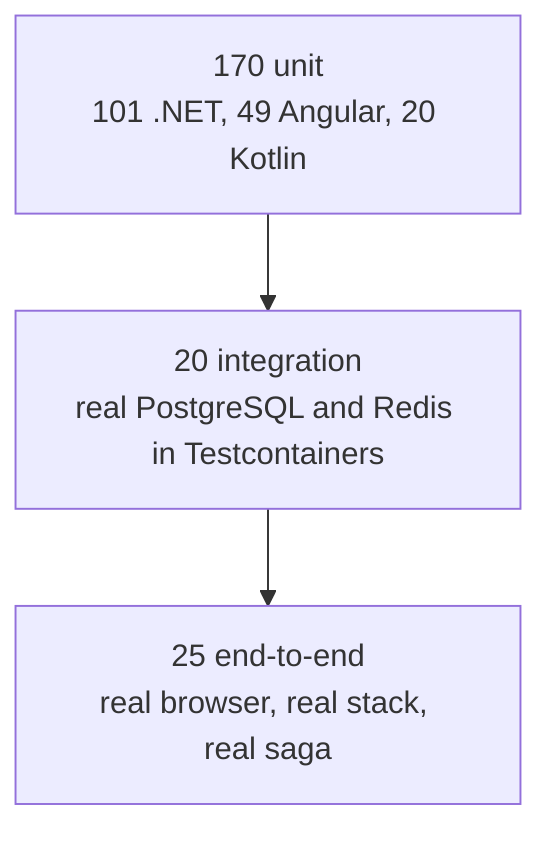

| Suite | Command | Covers |
|---|---|---|
| .NET unit | `dotnet test tests/Sama.UnitTests` | Money rounding, Result, access scopes, aggregates driven out of order |
| .NET integration | `dotnet test tests/Sama.IntegrationTests` | Query filters becoming SQL, partial indexes, Lua atomicity under concurrency |
| Angular unit | `./scripts/test-web.sh` | Auth service, interceptors, guards, theme, translations, RTL encapsulation |
| Kotlin unit | `cd src/mobile/sama-android && ./gradlew test` | Currency precision, wire-contract tolerance |
| End-to-end | `cd tests/e2e && npm test` | Browse, register, checkout, saga settlement, back office |
| Shell (API) | `./scripts/test-all.sh` | Five suites against the running stack |
| Contrast | `./scripts/check-contrast.py` | Every rendered colour pairing against WCAG AA, both themes |

The integration suite runs against real infrastructure on purpose. An in-memory substitute
would pass while production failed: what needs proving is that a model-level filter really
becomes a `WHERE` clause, that a partial unique index behaves as intended, and that 50
concurrent rate-limit acquisitions against a limit of 10 admit exactly 10.

> **Note.** Vitest receives absolute paths as glob patterns, so a checkout path containing
> parentheses never matches itself and the runner reports "No test files found" immediately
> after listing the files it found. `scripts/test-web.sh` stages the sources at a clean path
> and runs there, so the suite works from any checkout. See
> [src/web/sama-web/TESTING.md](src/web/sama-web/TESTING.md).

---

## Repository layout

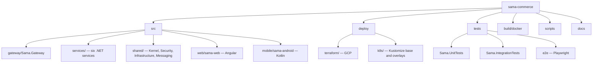

The shared libraries are where the cross-cutting concerns live once instead of six times:
`Kernel` (Result, Money, paging, domain primitives), `Security` (JWT, permissions, tenancy,
access scopes), `Infrastructure` (caching, rate limiting, EF base context, telemetry) and
`Messaging` (outbox, Pub/Sub publisher and subscriber).

---

## Documentation

- [Architecture](docs/01-architecture.md) — services, data ownership, caching, the saga
- [Security](docs/02-security.md) — threat model, and what answers each part of it
- [Operations](docs/03-operations.md) — runbook, failure modes, alerting, recovery
- [Design system](docs/04-design-system.md) — palette, type, theming, and how Arabic is handled
