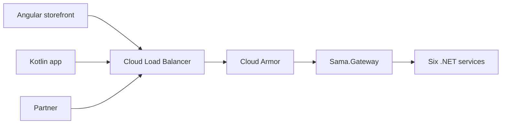
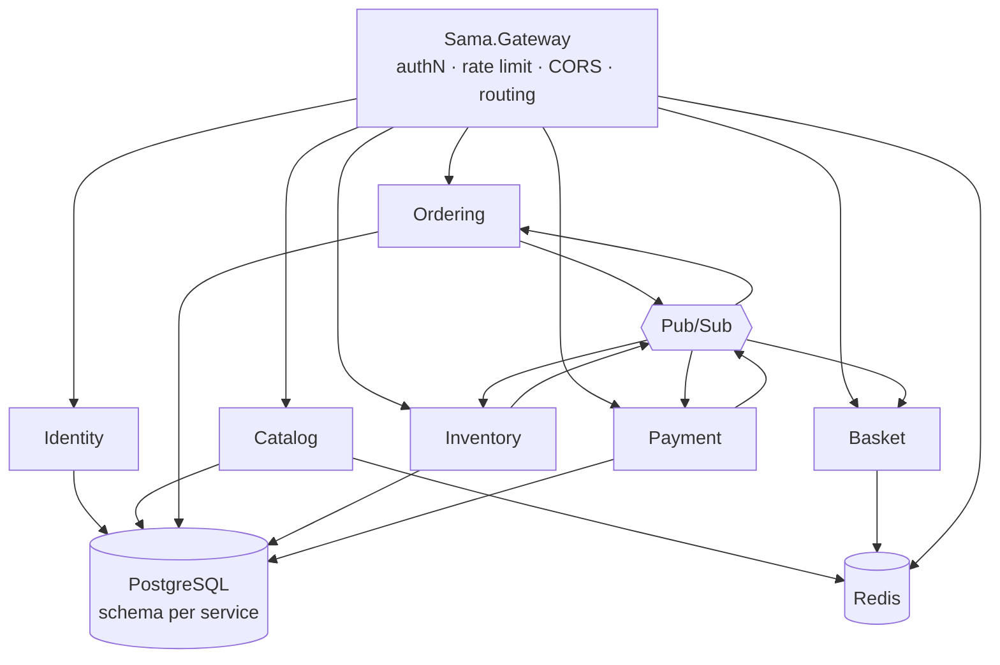
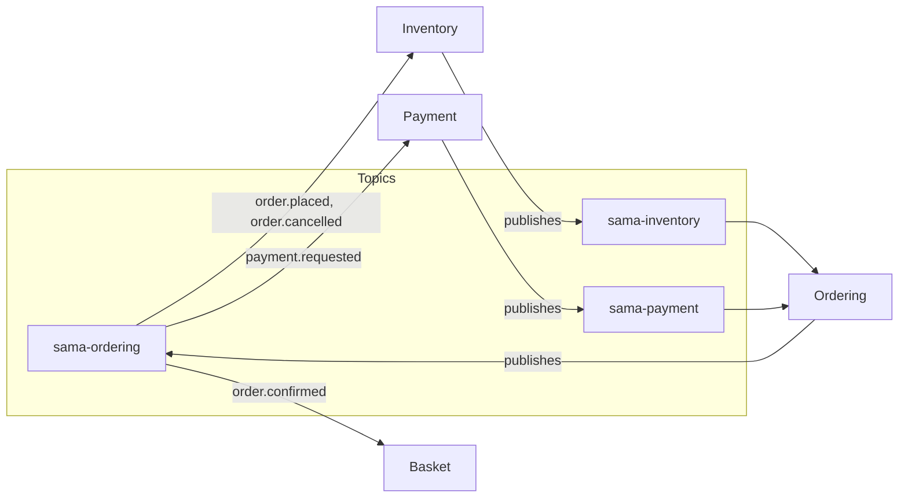
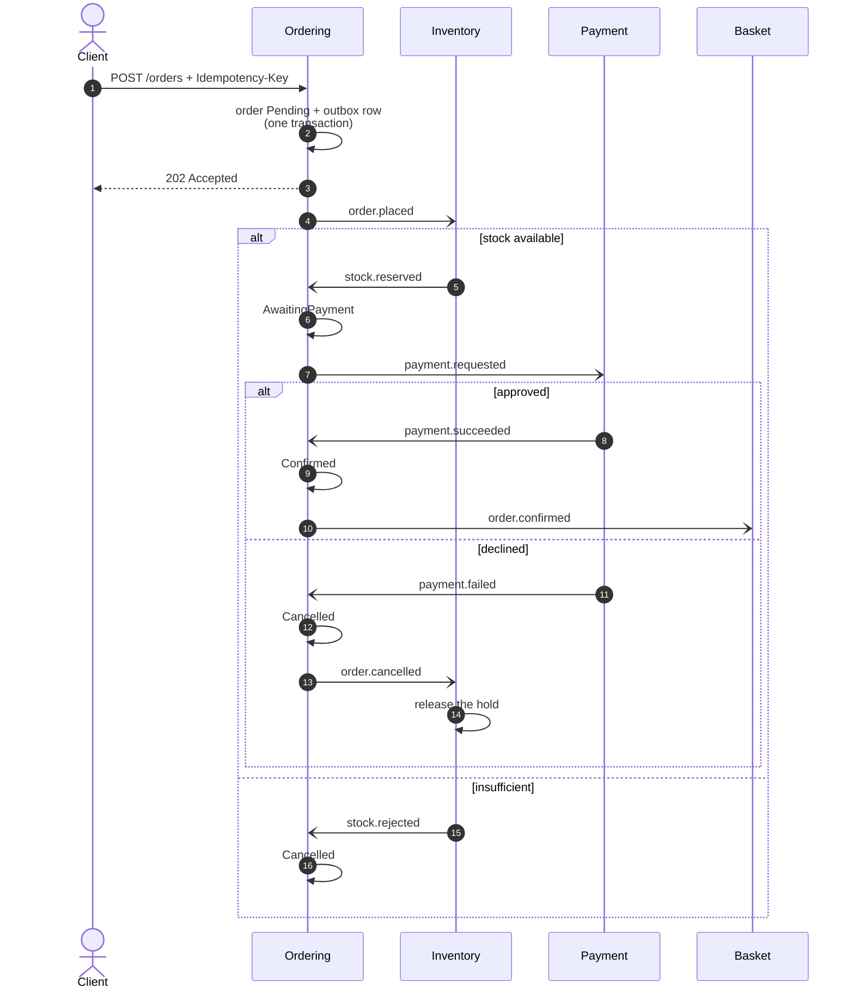
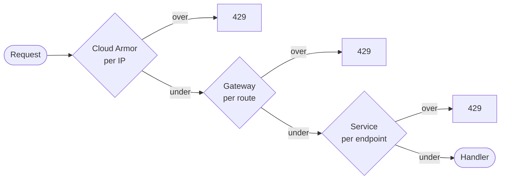
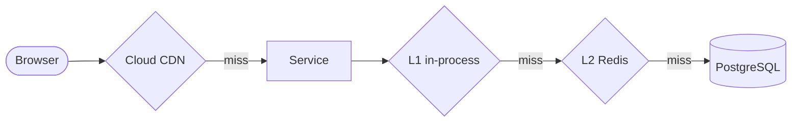

# Sama — System Architecture

> Target platform: **Google Cloud**. Runtime: **GKE Autopilot**, regional.
> Every section below maps to code in this repository.

---

## 1. Context

Sama is a multi-channel commerce platform. Three clients talk to one edge.

| Client | Tech | Path |
|---|---|---|
| Web storefront and back office | Angular 22, standalone, signals, zoneless | `src/web/sama-web` |
| Android app | Kotlin, Jetpack Compose, Hilt | `src/mobile/sama-android` |
| Partner integrations | REST over the same gateway | — |

---

## 2. Service map

### 2.1 Ownership

| Service | Owns | Store | Public API | Emits |
|---|---|---|---|---|
| `Sama.Gateway` | edge policy | Redis for limits | all public routes | — |
| `Sama.Identity` | users, roles, refresh tokens | `identity` | `/api/v1/auth/*`, `/api/v1/users/*` | `user.registered` |
| `Sama.Catalog` | products, categories | `catalog` | `/api/v1/products/*`, `/api/v1/categories` | `product.priceChanged`, `product.published` |
| `Sama.Basket` | active carts | Redis only | `/api/v1/basket/*` | — |
| `Sama.Ordering` | orders, saga state | `ordering` | `/api/v1/orders/*` | `order.placed`, `payment.requested`, `order.confirmed`, `order.cancelled` |
| `Sama.Inventory` | stock, reservations | `inventory` | `/api/v1/stock/*` | `stock.reserved`, `stock.rejected` |
| `Sama.Payment` | payment intents | `payment` | `/api/v1/payments/*` | `payment.succeeded`, `payment.failed` |

**The rule:** no service reads another service's tables. Cross-service reads are HTTP, on the
read path. Cross-service writes are events, on the write path.

### 2.2 Topics

One topic per **publishing** service. Consumers attach a filtered subscription for only the
event types they handle, which keeps the topic count flat as the catalogue of events grows.

`PaymentRequested` carries an `ordering.` prefix despite being about a payment, because the
topic is derived from the first segment and the invariant that keeps routing comprehensible is
*one topic per publishing service*. Naming it `payment.*` would publish it to the topic Payment
itself owns, leaving that service subscribed to its own output.

---

## 3. The checkout saga

Choreographed, with compensations, driven by events written through a transactional outbox.

Every consumer is idempotent. Handlers deduplicate on `(subscription, messageId)` in Redis with
a 24-hour TTL, so Pub/Sub's at-least-once delivery is safe. Two unique indexes back that up in
the database: `stock_reservations.order_id` and `payments.order_id`.

---

## 4. Cross-cutting concerns

| Requirement | Where | How |
|---|---|---|
| **Rate limiting** | Cloud Armor + gateway + service | Three layers. See §5 |
| **Caching** | `Sama.Shared.Infrastructure` | In-process L1 in front of Redis L2, stampede-protected, tag-invalidated |
| **CDN** | Cloud CDN on the load balancer | Angular bundle, product media, and cacheable product reads |
| **Scaling** | HPA on Autopilot | CPU-driven per service, PDBs, zone spread |
| **Load balancing** | GCLB with NEGs | Container-native: the LB targets pod IPs directly |
| **Auth** | `Sama.Shared.Security` | RS256 JWT, JWKS rotation, 15-minute access tokens |
| **Permissions** | `Sama.Shared.Security` | Permission-based policies, never role checks |
| **Data access control** | `Sama.Shared.Infrastructure` | EF Core model-level filters: tenant, ownership, soft delete |
| **Observability** | `Sama.Shared.Infrastructure` | OpenTelemetry to Cloud Trace, structured logs to Cloud Logging |

---

## 5. Rate limiting

| Policy | Limit | Partition | Guards against |
|---|---|---|---|
| `auth-login` | 5 / 5 min | IP **and** username | Credential stuffing, from both directions |
| `auth-register` | 3 / hour | IP | Automated signup abuse |
| `auth-refresh` | 600 / 5 min | IP | Volume only — see below |
| `checkout` | 10 / min | user | Expensive: two service calls plus a transaction |
| `search` | 30 / min | user | Reaches the full-text index on every distinct phrase |
| `write` | 60 / min | user | General mutation |
| `read` | 600 / min | user | General browsing |

Browsing and searching are metered separately on purpose. A paged listing is served from cache
and costs almost nothing; a search term reaches the database. Charging both to the same bucket
would either throttle ordinary browsing or leave search effectively unprotected.

Refresh is deliberately loose. It cannot be brute-forced — it needs an unguessable 256-bit
token, and replaying a consumed one already revokes the whole family — so a tight limit would
mostly punish legitimate users sharing an address behind corporate or carrier-grade NAT.

---

## 6. Caching

| Layer | TTL | Invalidation |
|---|---|---|
| Browser | `max-age=60` | `ETag` revalidation |
| Cloud CDN | `s-maxage=300`, `stale-while-revalidate=600` | Cache-tag purge on price change |
| Redis L2 | 5 min products, 1 h category tree | Tag-based, on write |
| In-process L1 | 30 s | Coordinated by `HybridCache` |

L1 is deliberately much shorter than L2: it is per-pod and cannot be invalidated across the
fleet, so a stale L1 entry is the one thing tag invalidation cannot immediately fix.

**Never cached:** `/api/v1/basket`, `/api/v1/orders`, `/api/v1/auth`, and every back-office
route. These carry `Cache-Control: no-store`, and the CDN bypasses on `Authorization`.

---

## 7. Data

- **PostgreSQL 16** on Cloud SQL, private IP only, regional HA, PITR, automated backups.
- **Schema per service** on one instance, each with **its own database role** granted on only
  its own schema. Cheaper than an instance each, isolates what matters, and a schema can be
  lifted onto its own instance later by changing one connection string.
- Migrations are EF Core, applied by a **Kubernetes Job** on deploy — never by the app at
  startup, which would have every replica race to run them.
- **Redis** for cache, baskets, rate-limit counters, idempotency records and the token denylist.

The full schema, with the reasoning behind each index and column type, is in the
[README's database design section](../README.md#database-design).

---

## 8. Environments

| Env | GKE | Cloud SQL | Redis | Replicas | Namespace |
|---|---|---|---|---|---|
| dev | Autopilot | `db-g1-small`, zonal | 1 GB basic | 1 | `sama-dev` |
| staging | Autopilot | `db-custom-2-7680`, regional | 4 GB standard | 2 | `sama-staging` |
| prod | Autopilot, regional | `db-custom-4-15360`, regional HA | 10 GB standard HA | 3–30 (HPA) | `sama` |

Environments are separated by **namespace** rather than by a Kustomize `nameSuffix`. A suffix
renames the `ExternalSecret` resource but not the `spec.target.name` inside it, so the Secret
it creates would keep the unsuffixed name while the Deployments referenced the suffixed one —
a mismatch that only shows up as pods failing to start.

---

## 9. Repository layout

| Path | Contents |
|---|---|
| `src/gateway/Sama.Gateway` | YARP edge: auth, rate limiting, routing |
| `src/services/*` | Six .NET services, one schema each |
| `src/shared/Sama.Shared.Kernel` | Result, Money, paging, domain primitives |
| `src/shared/Sama.Shared.Security` | JWT, permissions, tenancy, access scopes |
| `src/shared/Sama.Shared.Infrastructure` | EF base context, caching, rate limiting, telemetry |
| `src/shared/Sama.Shared.Messaging` | Event contracts, outbox, Pub/Sub |
| `src/web/sama-web` | Angular storefront and back office |
| `src/mobile/sama-android` | Kotlin app |
| `deploy/terraform` | GCP infrastructure |
| `deploy/k8s` | Kustomize base and per-environment overlays |
| `build/docker` | Container images |
| `tests` | Unit, integration and end-to-end suites |
