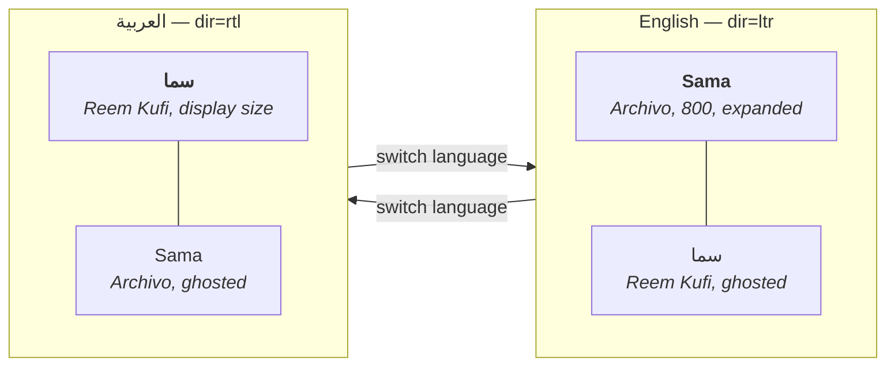
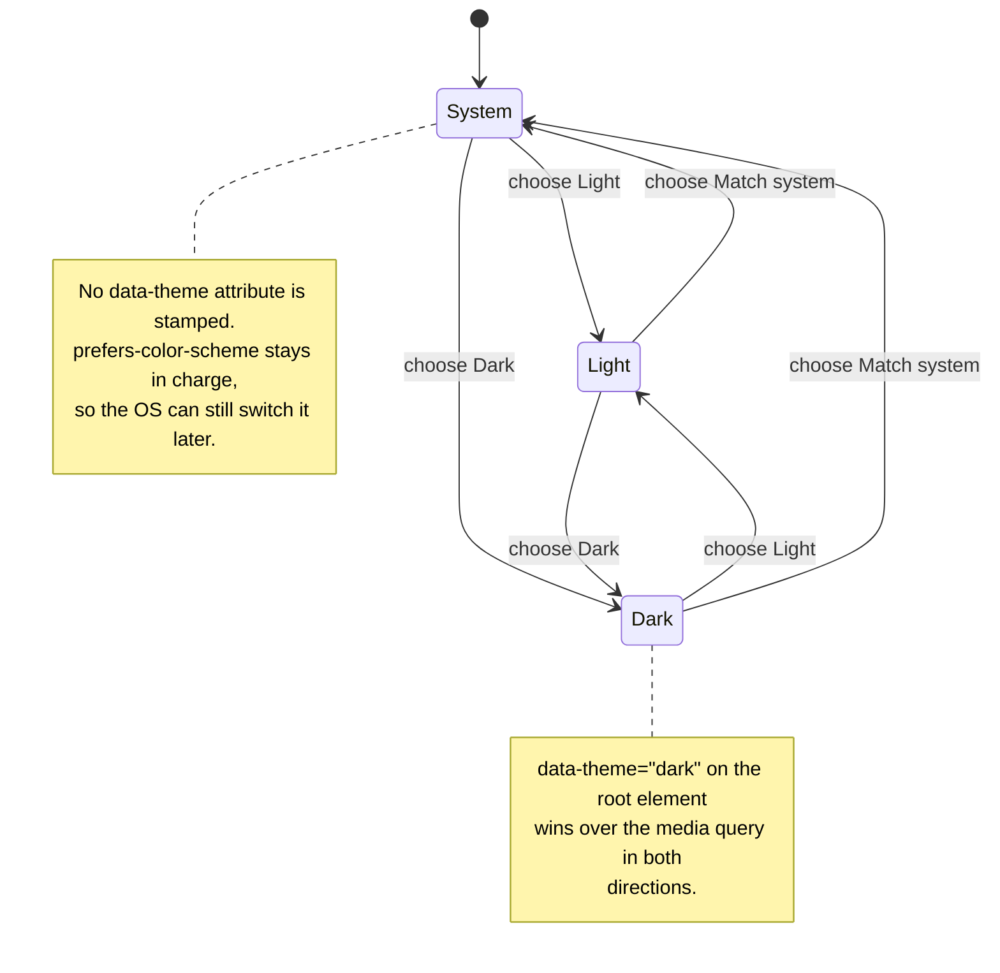
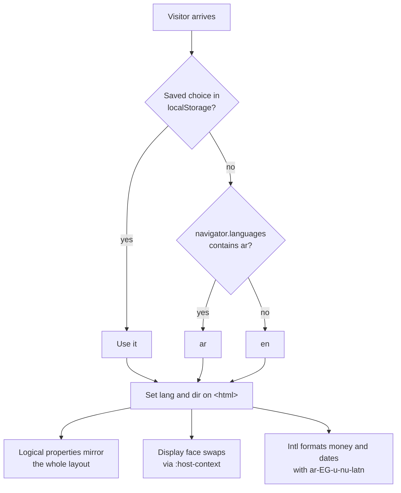
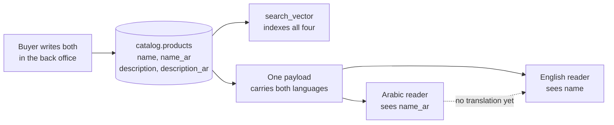

# The Sama design system

Sama sells clothing, shoes and electronics to customers in Cairo, Dubai, Riyadh
and Amman. Half of them read Arabic. That single fact decides most of what
follows: bilingualism is not a feature bolted onto a finished English shop, it is
the constraint the interface is built around.

## Contents

- [Direction](#direction)
- [Colour](#colour)
- [Type](#type)
- [Theming](#theming)
- [Localisation and direction](#localisation-and-direction)
- [Bilingual product content](#bilingual-product-content)
- [The pitfall that cost the most](#the-pitfall-that-cost-the-most)
- [Contrast](#contrast)
- [Layout and components](#layout-and-components)

## Direction

*Sama* (سما) means sky. The palette is taken from a city at dusk: a deep
indigo-teal ground, the turquoise of Fatimid and Iznik ceramic glaze, and the
amber of sodium street lighting.

The one loud gesture is the **dual-script masthead**. Both scripts are always
present; the active language is the wordmark and the other sits behind it,
ghosted. Switching language trades their places and mirrors the whole page.



Everything around it stays quiet. The departments are the hero of the home page,
not a slogan: the page's single job is to get someone into one of three rooms.

## Colour

The brand field is constant across both themes, so the identity does not invert
when someone flips the lights. Only the chrome adapts.

| Token | Light | Dark | Used for |
| --- | --- | --- | --- |
| `--sama-field` | `#0B1D28` | `#0B1D28` | Hero and footer ground, both themes |
| `--accent` | `#0C776E` | `#2FD4C6` | Primary actions, active state, chart bars |
| `--warm` | `#B8761A` | `#E9A13B` | Caution, sale, the one warm note |
| `--bg` | `#EBEEEC` | `#08131A` | Page ground — pale plaster, not cream |
| `--surface` | `#F7F9F7` | `#0F212B` | Cards, tables, menus |
| `--text` | `#0E1A1F` | `#E6EEF0` | Body copy |

Semantic pairs (`--positive`, `--caution`, `--critical`) each carry a matching
`-wash` for chip backgrounds, so a status never relies on hue alone at small
sizes.

## Type

Three faces, each with a job:

| Role | Face | Why |
| --- | --- | --- |
| Latin display | **Archivo** (variable, to 125% width) | Wide and editorial without reaching for the serif every other shop uses |
| Arabic display | **Reem Kufi** | Geometric Kufic, from the same tradition as the glaze colour |
| Body, both scripts | **IBM Plex Sans Arabic** | One family covering Latin *and* Arabic, so line height and colour stay even when the script changes mid-page |
| Figures, codes | **IBM Plex Mono** | SKUs and order numbers, where character shapes must not be ambiguous |

Latin display type carries tight negative letter-spacing. Arabic display type
carries none — Arabic is a joined script and negative tracking damages it.

## Theming

Three states, not two. "Match system" is a real position, because someone whose
laptop switches at sunset expects the shop to follow.



The choice is applied twice: once by an inline script in `index.html` before
first paint, so a dark-mode visitor never sees a white flash while Angular boots,
and again by `ThemeService` once it loads. That inline script is the reason the
production CSP pins a SHA-256 hash instead of allowing `unsafe-inline`;
`scripts/check-csp-hash.sh` fails the build if the two drift apart.

## Localisation and direction

Translation happens at runtime, not build time, so the language can be switched
without reloading and without shipping two bundles.



Three decisions worth stating:

**English is the source of truth for the key set.** `TranslationKey` is derived
from the English dictionary, so a missing Arabic string is a compile error rather
than a raw key leaking onto a page. Tests additionally assert that no Arabic
entry is still holding its English source string.

**Western digits in both languages.** `ar-EG` defaults to Arabic-Indic numerals,
which would put ١٢٣ beside a price while the rest of the shop shows 123. The
locale tag forces `-u-nu-latn`; a test fails if any Arabic copy reintroduces
`٠-٩`.

**Logical properties everywhere.** `padding-inline`, `margin-inline-start`,
`border-inline-start`, `inset-inline` — never `left` or `right`. This is what
makes RTL a one-attribute change rather than a parallel stylesheet.

## Bilingual product content

Chrome being translated is only half of a bilingual shop. The catalogue itself
holds each product's name and description in both languages: `name` and
`description` are required, `name_ar` and `description_ar` are optional.



Three decisions worth stating:

**Both languages travel in every payload**, rather than the server picking one
from `Accept-Language`. Listings are cached at the CDN with a five-minute shared
max-age, and negotiating would require `Vary: Accept-Language` — which fragments
that cache across every browser locale string and is handled inconsistently by
intermediaries. Carrying both also means switching language re-renders from data
already in memory instead of refetching. The cost is a few dozen bytes per item.

**A translation is optional.** A product is often written in one language and
translated later; requiring the pair would mean an untranslated item cannot be
sold at all. The storefront falls back to the base text, so the worst case is one
Latin title on an Arabic page rather than a blank heading. Blank and
whitespace-only translations are normalised to null in the domain, because an
empty string satisfies a null check and would defeat that fallback.

**Arabic is searchable, with a caveat.** The generated `tsvector` covers the
Arabic name and description alongside the English ones, so searching `جلد`
returns the leather shoes. PostgreSQL ships no Arabic stemmer, so the `english`
configuration tokenises Arabic without stemming it: an exact term matches, a
morphological variant does not. That is a real limitation, and still far better
than Arabic search returning nothing.

One migration detail that cost a run: `search_vector` is a generated column whose
expression names the columns it reads, and EF scaffolded the `AlterColumn` that
adds `name_ar` to that expression *before* the `AddColumn` that creates it.
PostgreSQL rejected it outright. `Down` had the mirror fault. The statements are
reordered by hand, with the reason recorded in the migration.


## The pitfall that cost the most

Angular's emulated view encapsulation rewrites every selector in a component's
styles to carry that component's content attribute:

```scss
/* What you write, inside a component's styles */
[dir='rtl'] .dept__title { font-family: var(--sama-display-ar); }

/* What Angular emits */
[dir='rtl'][_ngcontent-abc] .dept__title[_ngcontent-abc] { ... }
```

`dir` lives on `<html>`, which never carries a component's content attribute, so
**the rule silently never matches**. Nothing throws and nothing logs.

The visible result was Arabic department headings rendering in Archivo — a
Latin-only face with no Arabic coverage — carrying the negative letter-spacing
meant for Latin display type, which visibly damages joined Arabic script. It was
exactly the failure the whole direction was meant to avoid, and it was invisible
until someone actually looked at the page in Arabic.

The fix is `:host-context()`, which is exempt from the rewrite:

```scss
:host-context([dir='rtl']) .dept__title { font-family: var(--sama-display-ar); }
```

Nineteen selectors were affected. `rtl-encapsulation.spec.ts` now reads every
component stylesheet and fails on a bare `[dir='rtl']`, so it cannot come back.
Global `styles.scss` is unencapsulated and is exempt.

A related trap: `backdrop-filter` creates a stacking context. The header bar uses
it, which trapped the account menu's `z-index` inside the bar and let the dismiss
scrim swallow clicks on the menu — including Sign out. The bar now carries its
own `position` and `z-index` to sit above the scrim.

## Contrast

Colour is the one part of a design system that can be measured rather than argued
about, and it is also the part that fails quietly. `scripts/check-contrast.py`
resolves the tokens out of `styles.scss`, follows `var()` indirection, and checks
every pairing the interface actually renders — 24 of them, in both themes —
against WCAG 2.1 AA. It runs in CI.

Writing it found ten failures in a palette that looked fine:

| Pairing | Was | Needed |
| --- | --- | --- |
| Eyebrows and hints on the page (light) | 2.61:1 | 4.5:1 |
| Eyebrows and hints on a card (light) | 2.88:1 | 4.5:1 |
| Control borders (light) | 1.55:1 | 3:1 |
| Control borders (dark) | 2.16:1 | 3:1 |
| Positive chip (light) | 4.40:1 | 4.5:1 |
| Caution chip (light) | 4.16:1 | 4.5:1 |
| Hints on a card (dark) | 4.39:1 | 4.5:1 |
| Accent link text on a card (light) | 4.00:1 | 4.5:1 |
| Accent chip on its wash (light) | 3.54:1 | 4.5:1 |
| White button label on the accent (light) | 4.23:1 | 4.5:1 |

The last three are the brand colour itself. The mid-tone glaze failed as link
text, as chip text, and behind a white button label; deepening it to `#0C776E`
clears all three, and a deeper glaze is closer to the Iznik ware it comes from
anyway. The dark theme keeps the bright variant, which already passed.

Fixing the muted grey alone would have collapsed the three-step text ramp into
two indistinguishable greys, so both steps moved together — `--text-soft` to
`#425258` and `--text-faint` to `#5D6B72`, which restores a visible hierarchy
with every step above 4.5:1.

**Two border weights, on purpose.** `--line` is decorative — card edges, table
wrappers, dividers — and sits below 3:1 deliberately, because drawing every card
at 3:1 boxes the whole interface in heavy rules. `--line-strong` is the boundary
of an actual control, which WCAG 1.4.11 requires to reach 3:1 against every
surface it sits on.

That distinction only helps if components pick the right one. Eight were reaching
for the decorative weight — the header search field, the language and theme
toggles, the sort and role selects, the product-image thumbnails, and two admin
inputs — all drawing their boundary at about 1.3:1. `control-borders.spec.ts`
now fails the build if a control does that again.

## Layout and components

Shared primitives keep screens from drifting apart:

| Component | Job |
| --- | --- |
| `app-site-header` | Promise bar, department nav, search, theme and language toggles, account menu, mobile drawer |
| `app-site-footer` | The same brand field as the hero, bracketing the page |
| `app-product-card` | One product tile, with Add always visible rather than on hover — a hover-only control is unreachable on a touchscreen |
| `app-status-chip` | Order, payment, product, stock and user status; resolves its own translation key so a status reads in Arabic on an Arabic page |
| `app-empty-state` | What a list shows when it has nothing in it, with an SVG icon rather than a typographic glyph that renders as tofu where the font lacks it |
| `app-trend-chart` | Daily revenue as inline SVG, with the figures repeated as a screen-reader table because a chart is a picture of numbers |
| `app-breakdown-bar` | Proportions as one stacked bar; lengths are easier to compare than angles, and five order statuses become unreadable slivers in a doughnut |

The quality floor, applied everywhere rather than announced: responsive to 320px,
visible keyboard focus, `prefers-reduced-motion` respected, and every interactive
control reachable without a pointer.
